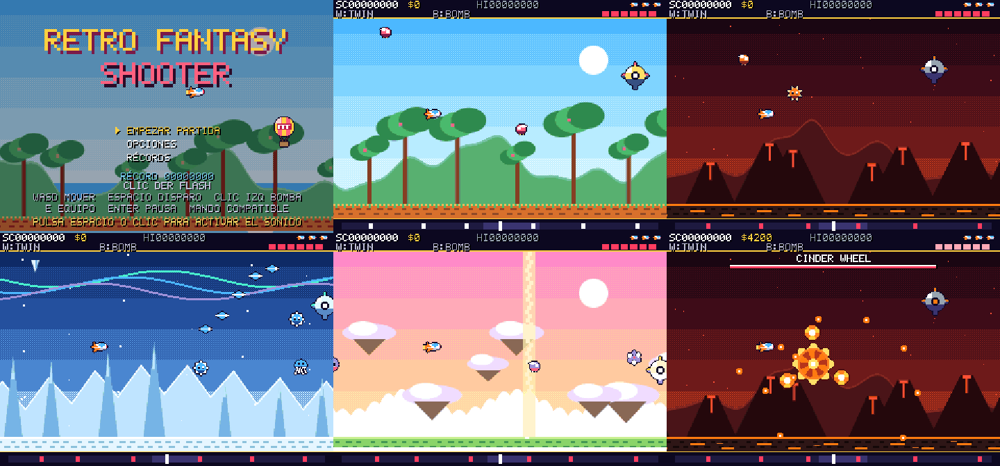
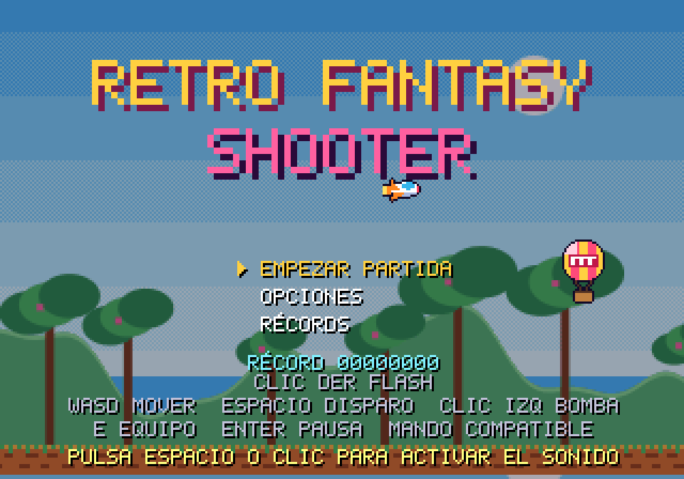
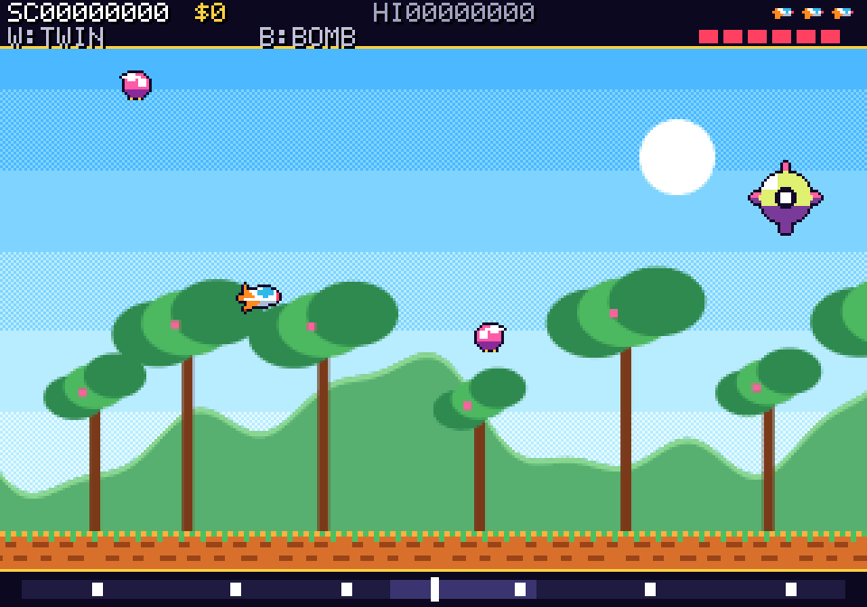
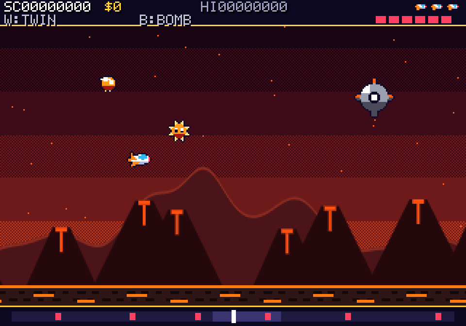
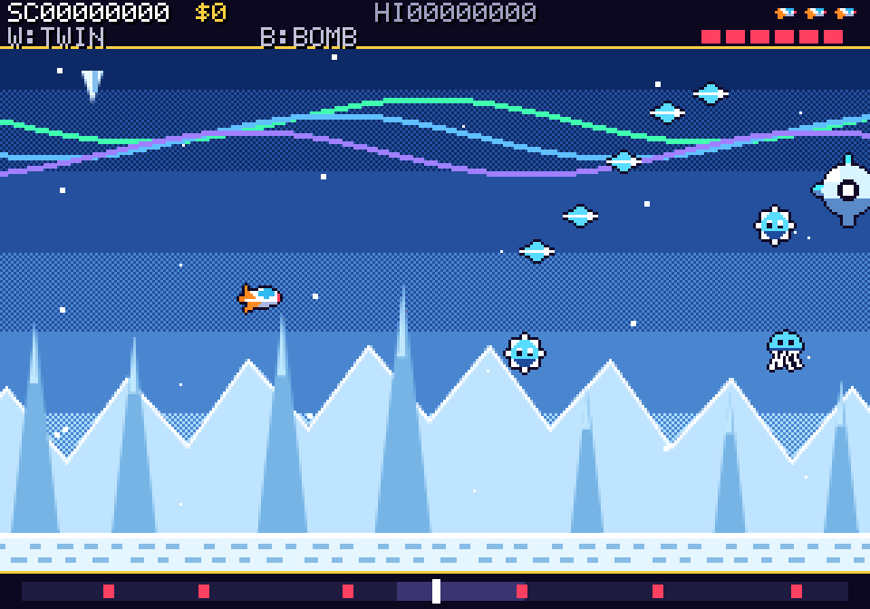
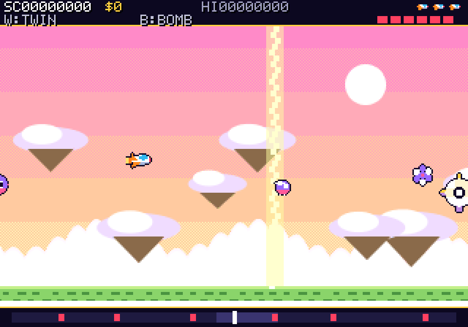
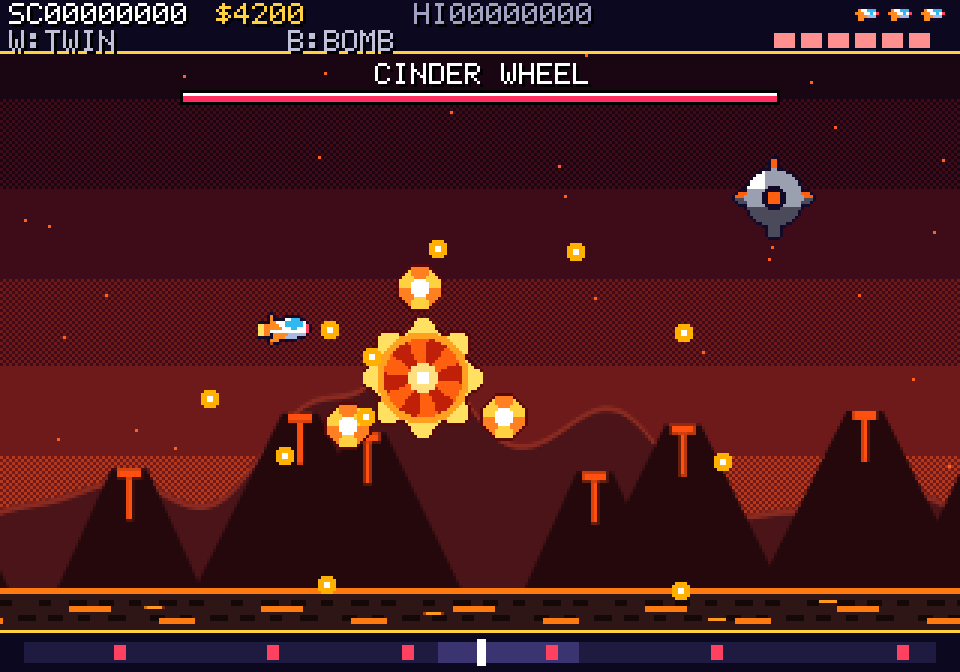

<p align="center"><a href="README.md">Español</a> · <b>English</b></p>

<div align="center">

# Retro Fantasy Shooter

**An 8-bit style horizontal shoot'em up you play in the browser.**
Art rasterized from code and chiptune music generated from seeds, with no dependencies at all: one `index.html` and you're playing.

[](https://virtuanista.github.io/retro-fantasy-shooter/)




</div>

This is an **original** game: its name, ship, enemies, bosses, stages, art and music are all its own.
It uses no external assets: everything is generated in the browser.

> **Inspired by** *Fantasy Zone* (Sega, 1986) and its Game Gear version: it shares the style of play
> (reversible horizontal scrolling, bases to destroy, coins and an upgrade shop).
> It is a non-profit fan project and is not affiliated with Sega. All the code, art and music
> in this repository are original. *Fantasy Zone* is a trademark of SEGA Corporation.

## Contents

- [How to play](#how-to-play)
- [Screenshots](#screenshots)
- [What's in the game](#whats-in-the-game)
- [Technical notes](#technical-notes)
- [Structure](#structure)
- [Tests](#tests)
- [Acceptance requirements](#acceptance-requirements)
- [License](#license)

## How to play

- **In the browser:** go to **[virtuanista.github.io/retro-fantasy-shooter](https://virtuanista.github.io/retro-fantasy-shooter/)**.
- **Offline:** download the repository and double-click `index.html`. No server, connection or installation needed.

Destroy the 6 bases in each zone to make the boss appear, collect the coins enemies drop
and spend them at the shop balloons on engines, weapons, bombs and extras. Careful: each purchase makes the next one more expensive.

| Action | Keyboard | Gamepad |
|---|---|---|
| Move (8 directions) | WASD (or arrow keys) | D-pad / stick |
| Main shot | Space (or Z) | A / RB |
| Bomb | Left click (or X) | B / X / LB |
| Flash Burst | Right click (or C) | Y |
| Quick equipment | E / Tab | Select |
| Pause | Enter / P | Start |

Keys can be remapped in **Opciones → Controles** (Options → Controls). Opciones is also where you set
the volume, scale and full screen. High scores are saved in `localStorage`.

**Debug mode** (`index.html?debug=1`, or `?debug=1&level=5` when served over HTTP):

| Key | Effect |
|---|---|
| 1 | Destroy the bases |
| 2 | +10000 $ |
| 3 | Invincible |
| 4 | Kill the boss |
| 5 | Next zone |
| 6 | Final stage |
| 7 | Shop balloon |

The state is in `window.__game`.

## Screenshots

| | | |
|---|---|---|
|  |  |  |
| **Title screen** | **Zone 1: Bosque Orgánico (Organic Forest)** | **Zone 2: Mundo Ígneo (Fire World)** |
|  |  |  |
| **Zone 3: Mundo Glacial (Ice World)** | **Zone 5: Mundo de Nubes (Cloud World)** | **Boss: Cinder Wheel** |

## What's in the game

| Zone | Name | Boss |
|---|---|---|
| 1 | Bosque Orgánico (Organic Forest) | Maw Engine: a mouth that opens as a window of vulnerability |
| 2 | Mundo Ígneo (Fire World) | Cinder Wheel: rings of bullets and three orbiting cores |
| 3 | Mundo Glacial (Ice World) | Frost Hydra: three heads and charges |
| 4 | Mundo Acuático (Water World) | Abyss Leviathan: frontal weak spot, charges and parabolic bullets |
| 5 | Mundo de Nubes (Cloud World) | Storm Flock: two waves and then the Eye, with an increasing rate of fire |
| 6 | Mundo Desértico (Desert World) | Dune Behemoth: armored, with a head that is vulnerable when it peeks out, and mortars |
| 7 | Zona Final (Final Zone) | Core Colossus: bursts, a spiral and a charge followed by an opening |
| Final stage | Núcleo Abisal (Abyssal Core) | All 7 bosses again (faster) and then **Abyssal Crown**: 3 phases and a final destruction sequence |

Each zone has its own hazards: lava or sand geysers, icicles, rising mines and lightning bolts.

The shop has 16 items in 4 categories, each with its own inflation:

| Item |
|---|
| Feather Fins |
| Ion Jet |
| Turbo Core |
| Comet Drive |
| Rear Shot |
| Fan Shot |
| Beam Laser |
| Seeker Shot |
| Twin Drop |
| Nova Bomb |
| Twin Rockets |
| Mega Bomb |
| Shield |
| Flash Burst |
| Auto Shot |
| Extra Ship |

## Technical notes

- **Not a single image or audio file**: sprites are rasterized from code at startup, and the music is a chiptune sequencer that generates each song from a seed.
- **Circular world**: each zone is a horizontal loop (*wrap-around*), so you can fly in both directions without ever reaching the end.
- **Simulation separate from drawing**: the logic runs at 60 Hz with a fixed step and does not depend on rendering, so the tests play entire games in Node, without a browser.
- **A bot beats the game**: in the tests, an invincible bot completes all 7 zones, the final stage and the ultimate boss in about 25 minutes of simulated play.
- **Balance in a single file**: levels, enemies, bosses, prices and inflation are in `js/config.js`.

## Structure

| File | Modules |
|---|---|
| `js/config.js` | **All the balance**: levels, enemies, bosses, prices and inflation, coins, hazards, music |
| `js/core.js` | Circular world (wrap-around) utilities and input (keyboard, gamepad, virtual) |
| `js/player.js` | PlayerController, PlayerCombat, PlayerHealth, WeaponSystem |
| `js/projectiles.js` | ProjectileSystem |
| `js/enemies.js` | EnemyController (8 families), EnemySpawner, EnemyBase |
| `js/bosses.js` | BossController and the 8 bosses |
| `js/economy.js` | CurrencySystem, EconomyManager, ShopInventory, EquipmentInventory |
| `js/stage.js` | StageManager, ShopController, HazardSystem |
| `js/game.js` | GameManager (states, menus, high scores, debugging) |
| `js/sprites.js`, `js/render.js` | Procedural art, HUDController and rendering |
| `js/audio.js` | Music and effects with WebAudio |
| `js/main.js` | Fixed-step loop at 60 Hz |

The simulation does not depend on rendering, so it can be run in Node.

## Tests

```
node test/sim-test.js
```

Runs the real logic without a browser and makes 41 checks:

- An invincible bot completes all 7 zones, the final stage and the ultimate boss, winning in about 25 min of simulated play.
- A passive game ends in game over.
- The economy, the shop, the inventory and the bomb damage caps against bosses are tested.
- Movement, shots, bombs and the transition to the boss are tested.
- Balance: a mortal bot with very simple dodging beats zone 1 on 4 out of 5 seeds and buys upgrades.

```
node test/browser-test.js <output_folder> "file:///path/to/index.html" test/sim-test.js
```

Opens headless Chrome and, using real key presses:

- Starts the audio.
- Goes through pause, equipment and the menus.
- Buys and uses every weapon and every bomb.
- Plays a full game while drawing the screen.
- Checks that the high scores are still there after reloading.

The result is zero exceptions in the console.

## Acceptance requirements

| Requirement | Evidence |
|---|---|
| Move in 8 directions | Test [4] "8/8 directions" |
| Shoot in both directions | Test [4] |
| Use bombs | Test [4]: bombs fall. Test [3]: they consume uses |
| 6 bases per level | Test [1] |
| Destroying the bases triggers the boss | Tests [1] and [4] |
| Enemies give rewards | Test [4] |
| Coins can be collected | Test [1]: $92,740 collected |
| The shop appears in the level | Tests [1] and [4] |
| All 4 types can be bought | Test [3] |
| Prices go up | Test [3]: 16/16 |
| Equipment selection ("EQ" item and E key) | Test [3] |
| Limited ammo or duration | Test [3]: Rear Shot and Fan Shot revert to the basic shot |
| Engines give speed | Test [3]: 1.35 → 3.0 |
| Bosses with distinct patterns | 8 bosses with their own logic. Test [1] |
| 7 levels | Test [1] |
| Final boss-rush stage | Test [1]: 15 bosses defeated |
| Game ends when all lives are lost | Test [2] |
| Progression from start to finish | Test [1]: money and difficulty grow by zone |

## License

Original code, art and music, released under the [MIT](LICENSE) license.

<p align="center">
	Repository made by <a href="https://github.com/virtuanista" target="_blank">virtu 🎣</a>
</p>

<p align="center">
	
</p>

<p align="center">
	Copyright &copy; 2026
</p>

<p align="center">
	<a href="LICENSE"></a>
</p>
