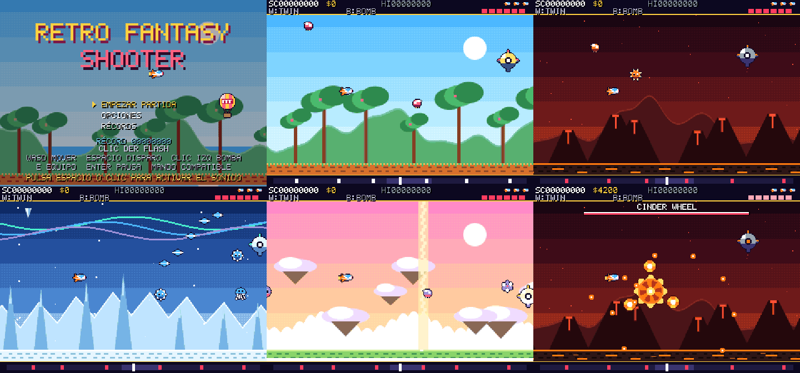
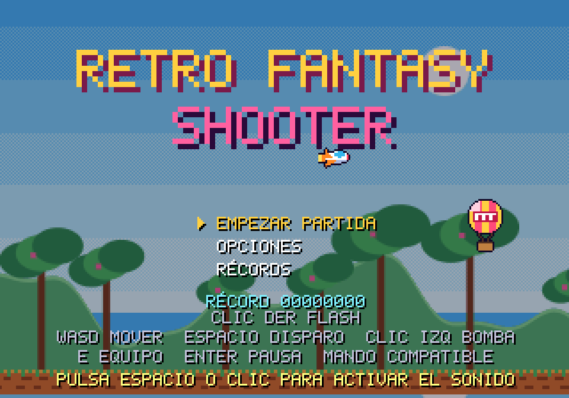
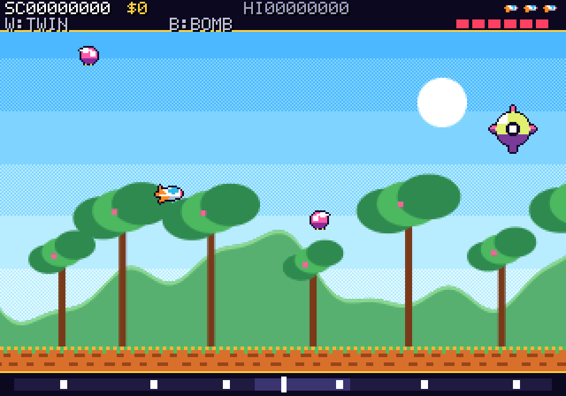
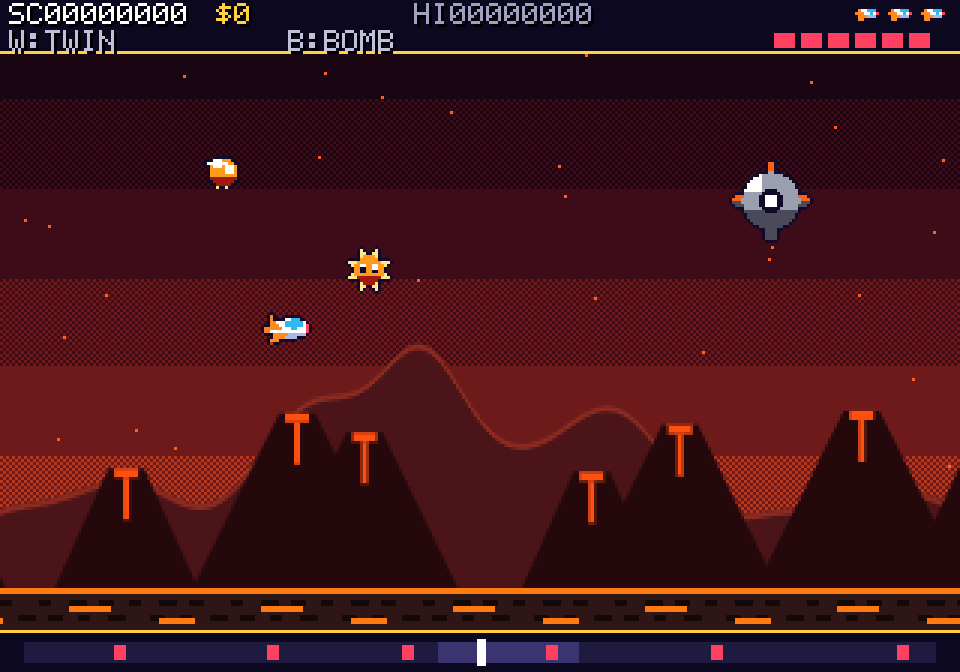
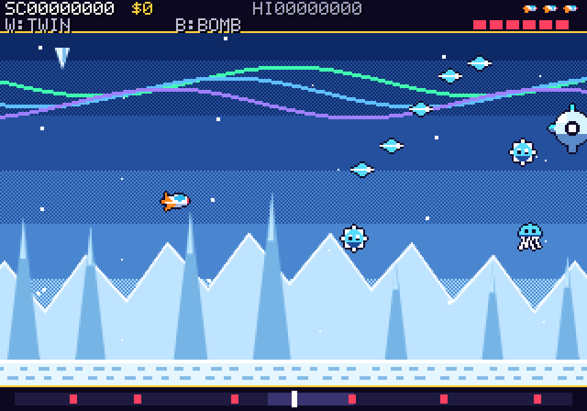
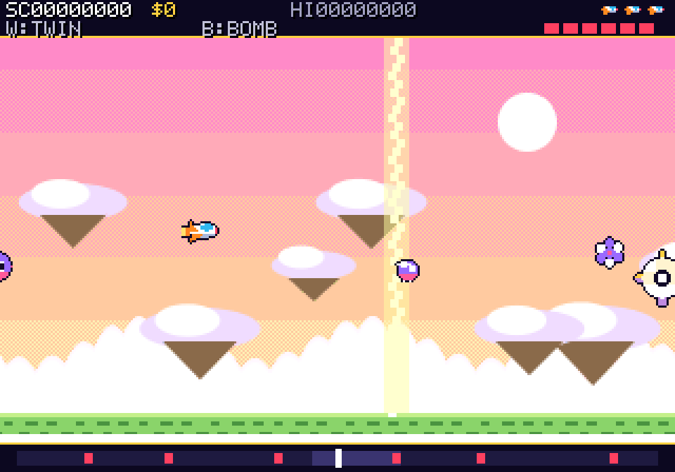
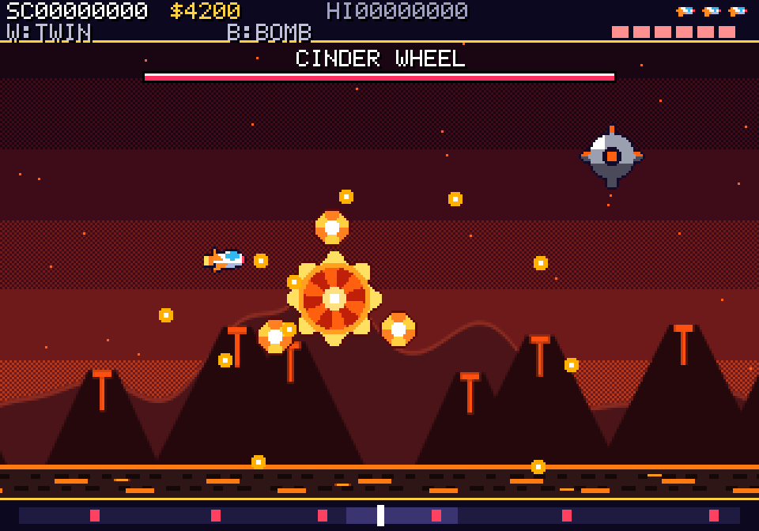

<p align="center"><b>Español</b> · <a href="README.en.md">English</a></p>

<div align="center">

# Retro Fantasy Shooter

**Shoot'em up horizontal de estilo 8 bits que se juega en el navegador.**
Arte rasterizado por código y música chiptune generada por semillas, sin ninguna dependencia: un `index.html` y a jugar.

[](https://virtuanista.github.io/retro-fantasy-shooter/)




</div>

Es un juego **original**: nombre, nave, enemigos, jefes, escenarios, arte y música son propios.
No usa recursos externos: todo se genera en el navegador.

> **Inspirado en** *Fantasy Zone* (Sega, 1986) y su versión para Game Gear: comparte el estilo de juego
> (desplazamiento horizontal reversible, bases que destruir, monedas y tienda de mejoras).
> Es un proyecto de fans sin ánimo de lucro y no está afiliado a Sega. Todo el código, el arte y la música
> de este repositorio son originales. *Fantasy Zone* es una marca de SEGA Corporation.

## Índice

- [Cómo jugar](#cómo-jugar)
- [Capturas](#capturas)
- [Contenido](#contenido)
- [Curiosidades técnicas](#curiosidades-técnicas)
- [Estructura](#estructura)
- [Pruebas](#pruebas)
- [Licencia](#licencia)

## Cómo jugar

- **En el navegador:** entra en **[virtuanista.github.io/retro-fantasy-shooter](https://virtuanista.github.io/retro-fantasy-shooter/)**.
- **Sin conexión:** descarga el repositorio y abre `index.html` con doble clic. No necesita servidor, conexión ni instalar nada.

Destruye las 6 bases de cada zona para que aparezca el jefe, recoge las monedas que sueltan los enemigos
y gástalas en los globos-tienda en motores, armas, bombas y extras. Cuidado: cada compra encarece la siguiente.

| Acción | Teclado | Mando |
|---|---|---|
| Mover (8 direcciones) | WASD (o flechas) | Cruceta / stick |
| Disparo principal | Espacio (o Z) | A / RB |
| Bomba | Clic izquierdo (o X) | B / X / LB |
| Flash Burst | Clic derecho (o C) | Y |
| Equipamiento directo | E / Tab | Select |
| Pausa | Enter / P | Start |

Las teclas se pueden reasignar en **Opciones → Controles**. En Opciones también se ajustan
el volumen, la escala y la pantalla completa. Los récords se guardan en `localStorage`.

**Modo depuración** (`index.html?debug=1`, o `?debug=1&level=5` si se sirve por HTTP):

| Tecla | Efecto |
|---|---|
| 1 | Destruir las bases |
| 2 | +10000 $ |
| 3 | Invencible |
| 4 | Matar al jefe |
| 5 | Siguiente zona |
| 6 | Fase final |
| 7 | Globo de tienda |

El estado está en `window.__game`.

## Capturas

| | | |
|---|---|---|
|  |  |  |
| **Título** | **Zona 1: Bosque Orgánico** | **Zona 2: Mundo Ígneo** |
|  |  |  |
| **Zona 3: Mundo Glacial** | **Zona 5: Mundo de Nubes** | **Jefe: Cinder Wheel** |

## Contenido

| Zona | Nombre | Jefe |
|---|---|---|
| 1 | Bosque Orgánico | Maw Engine: boca que se abre como ventana de vulnerabilidad |
| 2 | Mundo Ígneo | Cinder Wheel: anillos de balas y tres núcleos orbitantes |
| 3 | Mundo Glacial | Frost Hydra: tres cabezas y embestidas |
| 4 | Mundo Acuático | Abyss Leviathan: punto débil frontal, embestidas y balas parabólicas |
| 5 | Mundo de Nubes | Storm Flock: dos oleadas y después el Ojo, con cadencia creciente |
| 6 | Mundo Desértico | Dune Behemoth: acorazado, cabeza vulnerable al asomar y morteros |
| 7 | Zona Final | Core Colossus: ráfagas, espiral y embestida seguida de una ventana |
| Fase final | Núcleo Abisal | Los 7 jefes otra vez (más rápidos) y después **Abyssal Crown**: 3 fases y secuencia final de destrucción |

Cada zona tiene sus propios peligros: géiseres de lava o de arena, carámbanos, minas que suben y rayos.

La tienda tiene 16 artículos en 4 categorías, con inflación individual. Los nombres de los
artículos se agrupan por categoría:

| Artículo |
|---|
| Feather Fins |
| Ion Jet |
| Turbo Core |
| Comet Drive |
| Rear Shot |
| Fan Shot |
| Beam Laser |
| Seeker Shot |
| Twin Drop |
| Nova Bomb |
| Twin Rockets |
| Mega Bomb |
| Shield |
| Flash Burst |
| Auto Shot |
| Extra Ship |

## Curiosidades técnicas

- **Ni una imagen ni un audio**: los sprites se rasterizan por código al arrancar y la música es un secuenciador chiptune que genera cada canción a partir de una semilla.
- **Mundo circular**: cada zona es un bucle horizontal (*wrap-around*), así que puedes volar en ambos sentidos sin llegar nunca al final.
- **Simulación separada del dibujo**: la lógica corre a 60 Hz con paso fijo y no depende del render, así que las pruebas juegan partidas enteras en Node, sin navegador.
- **Un bot se pasa el juego**: en las pruebas, un bot invencible completa las 7 zonas, la fase final y el jefe definitivo en unos 25 minutos de juego simulado.
- **Balance en un solo fichero**: niveles, enemigos, jefes, precios e inflación están en `js/config.js`.

## Estructura

| Fichero | Módulos |
|---|---|
| `js/config.js` | **Todo el balance**: niveles, enemigos, jefes, precios e inflación, monedas, peligros, música |
| `js/core.js` | Utilidades de mundo circular (wrap-around) y entrada (teclado, mando, virtual) |
| `js/player.js` | PlayerController, PlayerCombat, PlayerHealth, WeaponSystem |
| `js/projectiles.js` | ProjectileSystem |
| `js/enemies.js` | EnemyController (8 familias), EnemySpawner, EnemyBase |
| `js/bosses.js` | BossController y los 8 jefes |
| `js/economy.js` | CurrencySystem, EconomyManager, ShopInventory, EquipmentInventory |
| `js/stage.js` | StageManager, ShopController, HazardSystem |
| `js/game.js` | GameManager (estados, menús, récords, depuración) |
| `js/sprites.js`, `js/render.js` | Arte procedural, HUDController y render |
| `js/audio.js` | Música y efectos con WebAudio |
| `js/main.js` | Bucle de paso fijo a 60 Hz |

La simulación no depende del render, así que se puede ejecutar en Node.

## Pruebas

```
node test/sim-test.js
```

Ejecuta la lógica real sin navegador y hace 41 comprobaciones:

- Un bot invencible completa las 7 zonas, la fase final y el jefe definitivo, con victoria en unos 25 min de juego simulado.
- Una partida pasiva termina en game over.
- Se prueban la economía, la tienda, el inventario y los topes de daño de las bombas contra jefes.
- Se prueban el movimiento, los disparos, las bombas y la transición al jefe.
- Balance: un bot mortal con una esquiva muy simple supera la zona 1 en 4 de 5 semillas y compra mejoras.

```
node test/browser-test.js <carpeta_salida> "file:///ruta/a/index.html" test/sim-test.js
```

Abre Chrome sin interfaz y, con teclas reales:

- Arranca el audio.
- Recorre pausa, equipamiento y los menús.
- Compra y usa cada arma y cada bomba.
- Juega una partida completa dibujando la pantalla.
- Comprueba que los récords siguen ahí tras recargar.

El resultado es cero excepciones en consola.

## Requisitos de aceptación

| Requisito | Evidencia |
|---|---|
| Moverse en 8 direcciones | Test [4] «8/8 direcciones» |
| Disparar en ambos sentidos | Test [4] |
| Usar bombas | Test [4]: las bombas caen. Test [3]: consumen usos |
| 6 bases por nivel | Test [1] |
| Destruir las bases activa al jefe | Tests [1] y [4] |
| Los enemigos dan recompensas | Test [4] |
| Las monedas se recogen | Test [1]: $92 740 recogidos |
| La tienda aparece en el nivel | Tests [1] y [4] |
| Se compran los 4 tipos | Test [3] |
| Los precios suben | Test [3]: 16/16 |
| Selección de equipamiento (objeto «EQ» y tecla E) | Test [3] |
| Munición o duración limitada | Test [3]: Rear Shot y Fan Shot vuelven al básico |
| Los motores dan velocidad | Test [3]: 1.35 → 3.0 |
| Jefes con patrones diferenciados | 8 jefes con su propia lógica. Test [1] |
| 7 niveles | Test [1] |
| Fase final de repetición de jefes | Test [1]: 15 jefes derrotados |
| Fin al perder todas las vidas | Test [2] |
| Progresión de principio a fin | Test [1]: el dinero y la dificultad crecen por zona |

## Licencia

Código, arte y música originales, publicados con licencia [MIT](LICENSE).

<p align="center">
	Repositorio generado por <a href="https://github.com/virtuanista" target="_blank">virtu 🎣</a>
</p>

<p align="center">
	
</p>

<p align="center">
	Copyright &copy; 2026
</p>

<p align="center">
	<a href="LICENSE"></a>
</p>
